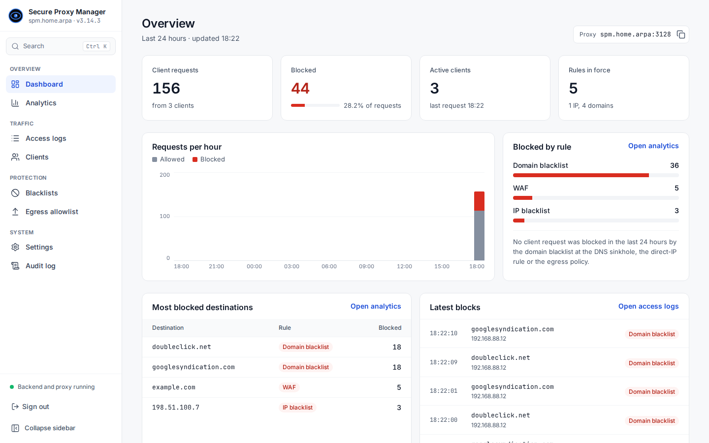

# Secure Proxy Manager

[](https://github.com/fabriziosalmi/secure-proxy-manager/releases)
[](https://github.com/fabriziosalmi/secure-proxy-manager/actions/workflows/ci.yml)
[](LICENSE)
[](https://github.com/fabriziosalmi/secure-proxy-manager/pkgs/container/secure-proxy-manager-proxy)
[](https://fabriziosalmi.github.io/secure-proxy-manager/)

Documentation: <https://fabriziosalmi.github.io/secure-proxy-manager/>

Secure Proxy Manager (SPM) is a self-hosted forward proxy for a home, lab or
small-office network. It runs as one Docker Compose stack: a Squid forward
proxy, a Go WAF that Squid calls over ICAP, a dnsmasq resolver that sinkholes
blocked domains, a Go backend with a REST API, and a React web UI.

It is for an operator who wants every client's outbound HTTP and HTTPS to pass
through one point they control: block domains and IP ranges, optionally allow
only an explicit list of destinations, inspect requests against WAF rules, and
see which client reached what. The proxy, the WAF and the data run on your
host. By default dnsmasq forwards lookups to public resolvers
(`DNS_UPSTREAM_1..3`), and the backend asks GitHub for the latest release
every 6 hours.



<sub>Malicious requests get **403**'d at the proxy by the WAF; benign traffic passes. Every category is verified with an adversarial test suite. See [Tested like an attacker](#tested-like-an-attacker).</sub>

[](https://fabriziosalmi.github.io/secure-proxy-manager/guide/tour)

<sub>Click the screenshot for a 30-second tour of the dashboard.</sub>

## Services

| Service | Built from | Role |
|---|---|---|
| `web` | `ui/` (nginx serving the React build) | HTTPS entry point: serves the UI, proxies `/api/` and the WebSocket to the backend |
| `backend` | `backend-go/` (Go, chi, SQLite) | REST API, authentication, settings, log ingestion, background workers |
| `waf` | `waf-go/` (Go) | ICAP service on port 1344 that inspects what Squid hands it |
| `proxy` | `proxy/` (Ubuntu 26.04, `squid-openssl`) | The forward proxy on port 3128 |
| `dns` | `dns/` (Alpine, dnsmasq) | Resolver used only by Squid; answers `0.0.0.0` and `::` for blocked domains |
| `tailscale` | `overlay/tailscale/` | Optional, started only with `--profile tailscale` |

The backend changes what the proxy enforces by writing files to the shared
`./config` directory: the exported lists, toggle marker files and trigger files
(`.reload-squid`, `.reload-dns`, `.clear-cache`). A watchdog in the proxy and
one in the dns container notice the change and apply it. No container mounts
the Docker socket. See [Architecture](docs/guide/architecture.md).

## Quick start

You need Docker with the Compose v2 plugin (`docker compose`). The published
release images are built for `linux/amd64` and `linux/arm64`.

**Installer (Linux server, run as root):**

```bash
curl -fsSL https://raw.githubusercontent.com/fabriziosalmi/secure-proxy-manager/main/deploy/install.sh | sudo bash
```

`deploy/install.sh` installs Docker if it is missing, clones the repository to
`/opt/secure-proxy-manager`, writes a `.env` with a random admin password,
`SECRET_KEY` and `INTERNAL_ALERT_TOKEN`, checks that the host ports are free,
pulls the release images from GHCR (and verifies their signatures when cosign
3 or later is installed), and starts the stack. It prints the credentials at
the end; they are also in `/opt/secure-proxy-manager/.env`.

**From a clone (builds the images locally):**

```bash
git clone https://github.com/fabriziosalmi/secure-proxy-manager.git
cd secure-proxy-manager
cp .env.example .env
# Edit .env:
#   BASIC_AUTH_PASSWORD   required: 8 or more characters, not a common default
#   INTERNAL_ALERT_TOKEN  recommended: openssl rand -hex 32 (WAF alerts and WAF controls need it)
docker compose up -d --build
```

Then open <https://localhost:8443> (or `https://<host>`), accept the
self-signed certificate and sign in with the credentials from `.env`. On the
first sign-in a short setup wizard offers a starting configuration.

Check that it works:

```bash
docker compose ps                                # all services healthy
curl -sk https://localhost:8443/api/health       # {"status":"healthy",...}
curl -x http://localhost:3128 -I http://example.com
```

To send a device through the proxy, set its HTTP and HTTPS proxy to
`<host>:3128`. Settings > Overview > Connect a device has per-platform
instructions and a PAC file. The proxy accepts clients from private IPv4
ranges, IPv6 unique-local and link-local addresses and localhost; add other
sources with `GUI_IP_WHITELIST`.

## Ports

| Host port | Service | Notes |
|---|---|---|
| 443, 8443 | `web` (HTTPS) | The UI and the API under `/api/` |
| 80, 8011 | `web` (HTTP) | Redirects to `https://<host>:8443`, except `/health`, `/wpad.dat` and `/.well-known/acme-challenge/` |
| 3128 | `proxy` | Bound to `PROXY_BIND_IP` (default `0.0.0.0`) |
| 127.0.0.1:5001 | `backend` | Reachable from the host only |

All of them must be free before the stack starts. A web server already on port
80 is the common clash: the `web` container cannot bind and the stack looks
slow to come up. `install.sh` checks the published ports first and names the
process holding one; free it, change the host side of the mapping, or set
`SKIP_PORT_CHECK=1` to continue anyway.

## What it does

- **Lists.** Blocked IPs, Blocked domains, Allowed IPs and Allowed domains, each
  managed on the Blacklists page or through the API, importable from a URL,
  pasted text, a curated list or a country's address blocks. Every entry
  records the source that added it, so an import can be removed as a whole.
  [Lists guide](docs/guide/blacklists.md).
- **DNS sinkhole.** dnsmasq answers `0.0.0.0` and `::` for every blocked
  domain, and Squid also denies those names itself while the list has at most
  `SPM_SQUID_DOMAIN_ACL_MAX` (250,000) entries.
- **Direct-IP and destination rules.** Squid always denies the IP blacklist and
  URLs that address a public IP directly; Allowed IPs and LAN destinations
  (`10.0.0.0/8`, `192.168.0.0/16`) are exempt from the direct-IP rule.
- **Default-deny egress (off by default).** With Settings > Filtering > Only
  allowlisted destinations on, clients reach only the entries on the Egress
  allowlist page, LAN destinations and Allowed IPs.
- **WAF.** 172 request rules in 21 categories and 5 response rules in 2
  categories (counted in `waf-go/internal/engine/rules.go`), six behavioural
  heuristics, anomaly scoring with a block threshold of 10, and runtime toggles
  per category. It blocks responses with executable content types and fails
  closed by default (`WAF_FAIL_OPEN=0`).
- **HTTPS.** HTTPS is tunnelled with `CONNECT` by default, so the WAF sees the
  destination only. Settings > Inspection > Inspect HTTPS traffic turns on
  SSL bump with a CA the proxy generates on first start; every client must
  trust that CA.
- **Access policy settings.** Proxy login, allowed hours, bandwidth limits,
  SafeSearch, YouTube restricted mode and blocked download extensions, in
  Settings.
- **Visibility.** Dashboard, Analytics, Access logs (server-side filters, CSV
  export, the stack's own traffic hidden by default), Clients, and an Audit log
  that records every list change and keeps rows for 365 days. A WebSocket feed
  streams new log rows to the UI.
- **Alerts.** WAF blocks and failed sign-ins can be sent to a webhook, Gotify,
  Telegram, ntfy or Microsoft Teams.
- **Operations.** Prometheus metrics on the internal network (backend
  `:5000/metrics`, WAF `:8080/metrics`), health probes `/livez` and `/readyz`,
  configuration backup and restore in Settings > Admin and backup.

Configuration is in `.env` (see [Configuration](docs/guide/configuration.md));
everything else is a setting stored in the database and edited in the UI.
The single-node design and its limits are in
[Architecture: limits](docs/guide/architecture.md#limits).

## Updating

Read the [CHANGELOG](CHANGELOG.md) entry for the version you move to first:
some releases list an **Action required** step that the commands below do not
perform. Re-running `deploy/install.sh` on an installed host pulls the new
version, adds variables an older `.env` lacks and copies `data/` to
`data.bak.<timestamp>` before it starts the new images. For a clone:

```bash
git pull
docker compose up -d --build
```

Backups, restore and rollback are in [DEPLOYMENT.md](DEPLOYMENT.md).

## Tested like an attacker

`make adversarial` (`bash tests/adversarial/run.sh`) builds an isolated
sandbox of the real images, attacks it and tears it down. CI runs it as the
required check *Adversarial block-matrix (proxy + WAF)* on every pull request
and push to `main`, and daily. It fails if any of five planes fails:

- **Block matrix.** 41 cases in `tests/adversarial/corpus.json` sent through
  the proxy and the WAF: 28 malicious cases that must be blocked, covering 19
  request categories and the 2 response categories, and 11 benign cases that
  must pass. One false negative or false positive among them fails the run.
  Two more cases (`UNICODE_OBFUSCATION`, `FINANCIAL_DATA`) are reported but do
  not gate.
- **API attacker.** 18 cases in `tests/adversarial/api-corpus.json` against
  the backend: unauthenticated and forged-token requests (including
  `alg=none`) must be refused, login SQL injection must fail, a login burst
  must be rate limited, and valid Basic and JWT requests must succeed.
- **Latency.** A k6 run through the proxy and the WAF must stay under a p95 of
  800 ms and a 5% error rate.
- **Config matrix.** Disabling a WAF category through the API lets that attack
  through while another category still blocks; enabling it blocks again.
- **Resilience.** With the WAF stopped, a request is not answered 200 (fail
  closed); after a restart traffic flows and attacks are blocked again; the
  dns container recovers after a restart.

Details: [tests/adversarial/README.md](tests/adversarial/README.md). Other
suites: `cd backend-go && go test ./...`, `cd waf-go && go test ./...`,
`cd ui && npm test`, and `scripts/pre-commit-validate.sh`, which runs the
TypeScript check, ESLint, `go vet`, the Go tests and the UI build.
`tests/ci-e2e.sh` is the CI smoke test: it writes its own `.env`, and on exit
deletes `.env` and runs `docker compose down -v`, so never run it in an
installed checkout.

## Manage it from an MCP client

[`mcp/`](mcp/) is a Model Context Protocol server, published on PyPI as
`spm-mcp`, that exposes part of the API as tools. It is read-only by default:
the tools that change the proxy (block a domain, toggle a WAF category, add an
egress entry, reload) are registered only with `SPM_MCP_READONLY=false`.

```bash
SPM_URL=http://localhost:5001 SPM_USERNAME=admin SPM_PASSWORD=... uvx spm-mcp
```

See [mcp/README.md](mcp/README.md).

## Security

- The admin password must be 8 or more characters and not a common default;
  the backend refuses to start otherwise. A `SECRET_KEY` you set must be 32 or
  more characters and not a known example value.
- The SSL-bump CA is generated per deployment under `config/` and is
  gitignored. Treat `config/ssl_key.pem` as a secret.
- Alert channel credentials are stored encrypted (AES-256-GCM) and are
  write-only through the API.
- The proxy denies FTP and keeps port 21 out of `Safe_ports`; the image build
  refuses a `squid-openssl` older than the floor in `proxy/Dockerfile`. See
  [Security Advisories](docs/guide/security-advisories.md).
- If port 3128 is reachable from outside your network, put it behind a
  firewall or a private network.

Report vulnerabilities privately, as described in [SECURITY.md](SECURITY.md).

## Documentation

- [Getting started](docs/guide/getting-started.md),
  [Configuration](docs/guide/configuration.md),
  [Lists](docs/guide/blacklists.md), [Security](docs/guide/security.md)
- [API reference](docs/api/reference.md); a running backend lists every
  route at `GET /api/docs` (authenticated)
- [DEPLOYMENT.md](DEPLOYMENT.md): installation, TLS, backups, upgrades
- [BENCHMARKS.md](BENCHMARKS.md): what has been measured, and how
- [CHANGELOG.md](CHANGELOG.md): release history

## Contributing

See [CONTRIBUTING.md](CONTRIBUTING.md). Issues and pull requests are welcome.

## Support

SPM is MIT-licensed and free to self-host. You can
[sponsor development](https://github.com/sponsors/fabriziosalmi). For
installation, hardening or managed operation for your organisation, email
fabrizio.salmi@gmail.com.

## License

[MIT](LICENSE).
